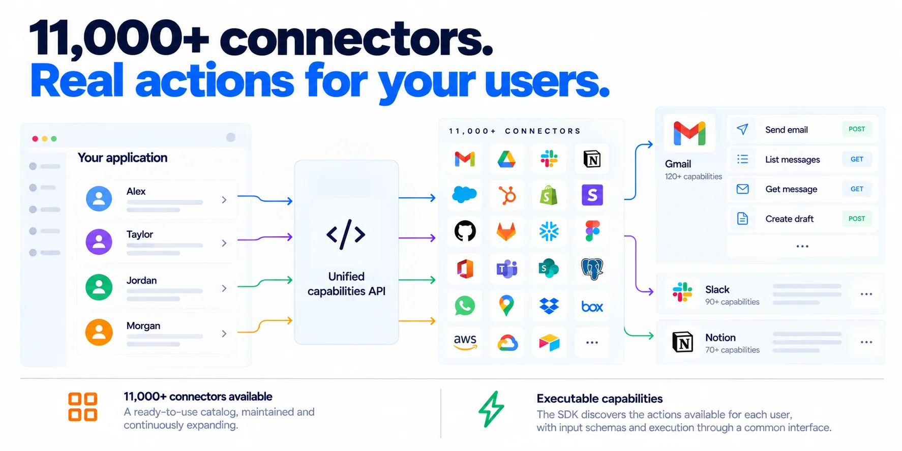

<div align="center">

# Vinkius Connect for Rush

### Build AI agents that act for each user.

One SDK for user-specific tools, credentials, permissions, and execution across **11,000+ systems** — developed in a Rush monorepo.

[](https://vinkius.com)
[](https://vinkius.com)

[Documentation](https://vinkius.com/learn/en/connect-sdk) · [Vinkius Cloud](https://cloud.vinkius.com) · [Site](https://vinkius.com)

</div>

---


<br >

AI applications become more useful when they can take action in the systems their users already work with. But shipping those actions means dealing with integrations, OAuth, credential storage, permissions, API changes, and model-specific tool formats.

**Vinkius Connect handles that connectivity layer.** Your application keeps its users and customer experience. Vinkius resolves each user's connected systems and available capabilities, executes actions on their behalf, and returns the result.



```text
Your AI application
        │
        │  Your authenticated user's external_id
        ▼
Vinkius Connect
  identity · connections · credentials · capabilities · execution
        │
        ├── GitHub
        ├── Slack
        ├── Project management
        └── 11,000+ connected systems
```

## Why Vinkius Connect?

- **Built for multi-user AI products.** Each user has their own connections and available capabilities.
- **One consistent interface.** Discover and execute actions without implementing each integration yourself.
- **Credentials stay out of model context.** Connector secrets are write-only through the documented API and are not returned to application code.
- **Framework flexibility.** Adapt capabilities to OpenAI, Anthropic, Gemini, LangChain, LlamaIndex, OpenAI Agents, CrewAI, or a neutral JSON Schema format.
- **Managed connectivity.** Vinkius maintains connectors and their evolving APIs.
- **Your product stays yours.** Use your application's own user IDs and keep the customer relationship and user experience in your product.

## How it works

1. **Identify the user.** Pass the stable `external_id` assigned by your application backend.
2. **Discover capabilities.** Vinkius resolves the user's ready connectors and the actions they expose.
3. **Provide tools to the model.** Convert those capabilities into the tool format expected by your model or framework.
4. **Execute the selected action.** Send the tool call to Vinkius and return the result to your agent loop.

The `external_id` is an identifier, **not an authentication mechanism**. Only pass an ID that your backend has associated with the currently authenticated user. Never trust a user ID supplied directly by an untrusted client.


## What is this repo?

This repository hosts **`@vinkius/connect`** — the Vinkius AI Connectivity Platform SDK — inside a [Rush](https://rushjs.io) monorepo. The published npm package is built from `packages/connect` and is consumed by any Node.js project exactly the same way:

```bash
npm install @vinkius/connect
```

This monorepo is for maintainers and for teams that standardize on Rush: versioned installs (`rush update`), parallel builds (`rush build`), bulk tests (`rush test`), change files, and lock-step publishing (`rush publish`).

```
ai-connect-sdk-rush/
├── packages/connect          # @vinkius/connect — the SDK (src, tests, 9 adapters)
├── common/config/rush/        # Rush configuration (pnpm, versioning, policies)
├── assets/                    # documentation media
└── rush.json                  # workspace manifest
```

## Installation

Node.js **18+** is required. The SDK uses native `fetch` and ships zero runtime dependencies.

### Install from npm

```bash
npm install @vinkius/connect
```

### Develop this monorepo

```bash
npm install -g @microsoft/rush@5.181.0
rush update     # install all project dependencies (pnpm)
rush build      # build @vinkius/connect (ESM + CJS + d.ts via tsup)
rush test       # run the vitest suites (fully offline)
rush lint       # eslint across the workspace
```

## Quick start

Create an AI application in [Vinkius Cloud](https://cloud.vinkius.com), then create an application key. Keep the key on your server. **Never expose it in browser code, mobile clients, or model prompts.**

Then discover and execute a capability:

```ts
import { Vinkius } from '@vinkius/connect';

const vinkius = new Vinkius({
  appId: 'vk_app_...',
  apiKey: 'vk_app_sk_...',
});

// Use the ID of the authenticated user from your own backend.
const user = vinkius.user('alice_123');

// Discover actions available through this user's ready connectors.
const capabilities = await user.capabilities();

// Execute one capability by its namespaced name.
const result = await capabilities
  .findCapability('github__create_issue')
  ?.execute({
    owner: 'acme',
    repo: 'product',
    title: 'Ship it',
  });

console.log(result?.content);
```

The capability name and input schema depend on the connector and capabilities available to that user. Discover available capabilities before attempting to execute one.

## Use capabilities with an AI model

The usual agent loop is straightforward:

1. Fetch the authenticated user's capabilities.
2. Convert them into the model's tool format.
3. Send the user's request and tools to the model.
4. Execute the returned tool call through Vinkius.
5. Return the result to the model as part of your agent loop.

### Example: OpenAI Chat Completions

```ts
import OpenAI from 'openai';
import { Vinkius } from '@vinkius/connect';
import { toOpenAITools, runOpenAIToolCall } from '@vinkius/connect/openai';

const openai = new OpenAI();
const vinkius = new Vinkius({ appId: 'vk_app_...', apiKey: 'vk_app_sk_...' });

// Resolve this ID only after authenticating the user in your backend.
const caps = await vinkius.user('alice_123').capabilities();

const response = await openai.chat.completions.create({
  model: 'gpt-4o',
  messages: [{ role: 'user', content: "Open a GitHub issue titled 'Ship it'" }],
  tools: toOpenAITools(caps),
});

const message = response.choices[0].message;
if (message.tool_calls?.length) {
  for (const toolCall of message.tool_calls) {
    const result = await runOpenAIToolCall(caps, toolCall);
    console.log(result.content);
  }
}
```

For a fuller example, see [`packages/connect`](packages/connect/README.md).

## Connect a user's system

Provision a connector for a user, set its credentials, check its status, and inspect its capabilities:

```ts
const vinkius = new Vinkius({ appId: 'vk_app_...', apiKey: 'vk_app_sk_...' });

const user = vinkius.user('alice_123');
const github = user.connector('github');

await github.connect();                 // get or create the connection
await github.credentials.set({ GITHUB_TOKEN: token });

const status = await github.status();
console.log(status);                    // not_connected, needs_credentials, ready, or disabled

const capabilities = await github.capabilities();
```

The example assumes `vinkius` is already configured and `token` was obtained securely. In a production application, prefer the supported authorization flow for the connector where available, and never ask users to paste secrets into an AI conversation.

Credential values are write-only through the documented interface. The credential schema and whether a value is set can be inspected; secret values cannot be read back.

## Framework adapters

A capability set can be converted to different tool formats. Adapter modules shape the tools; they do not require the target framework merely to perform the conversion. Install the relevant framework if your application or tests need it.

| Framework / format | Adapter subpath | Main functions |
| --- | --- | --- |
| OpenAI Chat Completions | `@vinkius/connect/openai` | `toOpenAITools`, `runOpenAIToolCall` |
| Anthropic Messages | `@vinkius/connect/anthropic` | `toAnthropicTools`, `runAnthropicToolUse` |
| Google Gemini | `@vinkius/connect/gemini` | `toGeminiTools`, `runGeminiFunctionCall` |
| LangChain | `@vinkius/connect/langchain` | `toLangChainTools` |
| LlamaIndex | `@vinkius/connect/llamaindex` | `toLlamaIndexTools` |
| OpenAI Agents | `@vinkius/connect/openai-agents` | `toOpenAIAgentsTools` |
| Vercel AI SDK | `@vinkius/connect/ai-sdk` | `toAISDKTools` |
| Cloudflare Workers AI | `@vinkius/connect/workers-ai` | `toWorkersAITools` |
| Framework-neutral | `@vinkius/connect/json-schema` | `toJSONSchemaTools`, `executeByName` |

Example:

```ts
import { toOpenAITools } from '@vinkius/connect/openai';
import { toAnthropicTools } from '@vinkius/connect/anthropic';
import { toGeminiTools } from '@vinkius/connect/gemini';
import { toJSONSchemaTools } from '@vinkius/connect/json-schema';

const caps = await vinkius.user('alice_123').capabilities();

const openaiTools = toOpenAITools(caps);
const anthropicTools = toAnthropicTools(caps);
const geminiTools = toGeminiTools(caps);
const jsonSchemaTools = toJSONSchemaTools(caps);
```

## Core concepts

| Concept | Meaning |
| --- | --- |
| **Connector** | An external system a user connects, such as GitHub or Slack. |
| **Capability** | An executable action exposed by a connector, such as listing repositories or creating an issue. |
| **User** | A user identified by your application's `external_id`. Vinkius does not require a separate end-user identity. |
| **Control plane** | Provisioning and state management for users, connectors, credentials, and catalog discovery. |
| **Execution plane** | Runtime capability discovery and execution, per user through a short-lived token. |

### Capability discovery behavior

`user.capabilities()` resolves the user's ready connectors in parallel, with concurrency capped at eight. A single unresponsive connector does not necessarily fail the whole batch. Use `on_connector_error` to observe individual connector failures. If all connectors fail, the first error is raised.

## Configuration

```ts
import { Vinkius } from '@vinkius/connect';

const vinkius = new Vinkius({
  appId: 'vk_app_...',
  apiKey: 'vk_app_sk_...',
  timeoutMs: 30_000,
  maxRetries: 2,
  userAgent: 'acme-ai/1.0',
  namespaceCapability: (connector, name) => `${connector}__${name}`,
  hooks: {
    onRequest: (info) => {
      /* redacted headers — secrets never reach the hook */
    },
  },
});
```

- **`appId`** identifies your Vinkius application.
- **`apiKey`** is a server-side secret. Keep it out of clients and prompts.
- **`timeoutMs`** sets the request timeout.
- **`maxRetries`** controls retries for retry-safe requests.
- **`fetch`** lets you inject a custom fetch implementation, useful for tests and custom transports.
- **`userAgent`** appends your application's identifier to the SDK user agent.
- **`namespaceCapability`** controls how connector and capability names are combined.
- **`hooks`** configures observability hooks; sensitive headers and bodies are redacted before hooks run.

The SDK is built on the runtime's native fetch and holds no persistent client to release. Pass `signal` to a request to abort an in-flight call when your agent loop is cancelled.


### Retries and idempotency

Transient HTTP statuses (`429`, `502`, `503`, `504`) and network errors are retried with full-jitter backoff only for retry-safe requests. Idempotent methods and requests carrying an `idempotency_key` may be retried. Non-idempotent POST requests, such as minting a connection token, are not automatically retried.

For actions that create or modify data in external systems, design your agent loop to account for duplicate requests and uncertain outcomes. Use idempotency support where available and appropriate.

## Low-level API

The fluent API has REST equivalents when you need more direct control:

```ts
const connection = await vinkius.users.connections('alice_123').create({
  connector: 'github',
});

await vinkius.users
  .connections('alice_123')
  .credentials(connection.id)
  .set({ credentials: { GITHUB_TOKEN: '...' } });

await vinkius.catalog.search('github');

for await (const connector of vinkius.catalog.iterate()) {
  console.log(connector);
}
```

## Error handling

SDK exceptions inherit from `VinkiusError` and expose a status, stable error code, and server `request_id` where available.

Common exception types include:

- `ConfigError`
- `AuthError`
- `NotFoundError`
- `ValidationError`
- `RateLimitError`
- `QuotaError`
- `OverageError`
- `ConnectorNotConnectedError`
- `ConnectionError`
- `ProtocolError`

```ts
import { VinkiusError, RateLimitError } from '@vinkius/connect';

try {
  const caps = await vinkius.user('alice_123').capabilities();
} catch (err) {
  if (err instanceof RateLimitError) {
    // Inspect retryAfterMs when present.
    console.log(err.retryAfterMs);
  } else if (err instanceof VinkiusError) {
    // Useful for logs and support; avoid logging secrets or sensitive payloads.
    console.log(err.code, err.status, err.requestId);
  }
}
```

Capability-level execution failures are returned as results with `isError` set, allowing an agent loop to pass the failure back to the model and recover. Transport, configuration, and protocol failures are raised as exceptions.

## Security practices

- **Keep application keys server-side.** Never ship `vk_app_sk_*` in frontend code, mobile applications, repositories, or prompts.
- **Authenticate users in your application.** Resolve `external_id` from trusted backend state; do not accept arbitrary user IDs from clients.
- **Scope actions to the right user.** Fetch and execute capabilities for the authenticated user's identity only.
- **Keep raw secrets out of prompts.** Connector credentials are write-only through the documented API and are not intended for model context.
- **Treat tool calls as actions.** Apply your product's confirmation, authorization, and policy requirements before executing sensitive or irreversible operations.
- **Protect logs.** Do not log API keys, tokens, credential values, or sensitive customer data.
- **Handle revocation and failures.** Make connection state visible in your product and define how your application responds when a connector is disabled, expired, or unavailable.

Vinkius Connect provides connectivity and execution primitives. Your application remains responsible for authenticating its users, enforcing product-level policy, and deciding when an AI-requested action requires confirmation.

## Development

This is a Rush monorepo. The standard day-to-day flow:

```bash
rush update        # install
rush build         # build the SDK (ESM + CJS + d.ts)
rush test          # vitest — 151 tests across 18 suites, fully offline
rush lint          # eslint
rush change        # record the change type before publishing
rush version       # bump versions + write CHANGELOG
rush publish       # publish @vinkius/connect to npm
```

The SDK's tests use an injectable fake transport and run offline.

## License

[Apache License 2.0](./LICENSE), Copyright Vinkius.